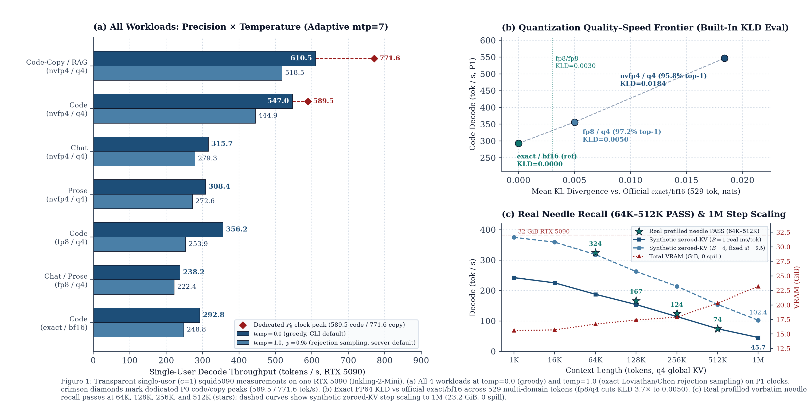

# squid5090

**A single-binary, zero-Python TigerStyle Zig + Blackwell CUDA (`sm_120a`) inference engine and OpenAI-compatible HTTP/SSE server for [`thinkingmachines/Inkling-2-Mini`](https://huggingface.co/thinkingmachines/Inkling-2-Mini) on an NVIDIA RTX 5090.**

> **Upfront Attribution:** Several core Blackwell kernel designs and features in `squid5090` — including Programmatic Dependent Launch (PDL) overlap, register-permuted `mma.m16n8k16` decode GEMVs, the `128×128×64` `cp.async` MoE prefill pipeline, device-side `{2, 4, 8}` CUDA Graph conditional switch drafting (`cudaGraphCondTypeSwitch`), and the 1.8 MB runtime-gated Fisher-LDA abliteration format & tooling — were adapted from [`satellitedown/inkling-2-mini-abliterated-ingine`](https://github.com/satellitedown/inkling-2-mini-abliterated-ingine) (Apache-2.0). Hybrid prompt-lookup drafting was inspired by [`AtomicBot-ai/atomic-engine`](https://github.com/AtomicBot-ai/atomic-engine), and the roofline workflow follows [`sybil-solutions/inference-optimisation-skill`](https://github.com/sybil-solutions/inference-optimisation-skill). Full attributions live in [`NOTICE`](NOTICE).



> **Deep Dives:**
> - **[`LITE.md`](LITE.md)** — Plain-English, 3Blue1Brown-style animated guide to GPU roofline optimization, speculative decoding, and geometric Fisher-LDA abliteration.
> - **[`LEARNINGS.md`](LEARNINGS.md)** — Complete technical reference: CUDA kernels, roofline math, KLD/quality analysis, remaining optimization headroom, and the `uv` abliteration pipeline.

---

## Benchmarks & Quality (Single RTX 5090, `c=1`)

All numbers below are measured directly on one RTX 5090 (32 GiB GDDR7) with `squid5090`'s built-in `bench`, `kld`, and `generate` commands. Every precision mode is evaluated for **exact FP64 KL divergence vs. the unmodified `exact / bf16` checkpoint** (`squid5090 kld`, 529 multi-domain tokens across Python, systems prose, math, and chat).

### 1. Precision × Quality (KLD) × Decode Throughput (`mtp=7`, Adaptive `{2,4,8}` + Prompt-Lookup)

| Mode / KV | Mean KLD vs. `exact/bf16` | Top-1 Match | PPL *(Ref `2.5555`)* | Code (`T=0.0` / `T=1.0`) | Code-Copy (`T=0.0` / `T=1.0`) | Chat (`T=0.0` / `T=1.0`) | Prose (`T=0.0` / `T=1.0`) | Weight VRAM |
|---|---:|---:|---:|---:|---:|---:|---:|---:|
| **`exact / bf16`** *(official)* | **0.0000** | 100.00% | 2.5555 | 292.8 / 248.8 tok/s | — | — | — | 18.28 GiB |
| `exact / fp8` | 0.0027 | 99.05% | 2.5645 | — | — | — | — | 18.28 GiB |
| `exact / q4` | 0.0052 | 97.73% | 2.5811 | — | — | — | — | 18.28 GiB |
| **`fp8 / fp8`** | **0.0030** | **98.49%** | 2.5706 | — | — | — | — | 16.85 GiB |
| **`fp8 / q4`** *(quality sweet spot)* | **0.0050** | **97.16%** | 2.5820 | **356.2 / 253.9 tok/s** | — | 233.6 / 208.7 tok/s | 242.8 / 236.2 tok/s | 16.85 GiB |
| `nvfp4 / fp8` | 0.0165 | 96.03% | 2.5900 | — | — | — | — | 14.57 GiB |
| **`nvfp4 / q4`** *(max speed / 1M)* | **0.0184** | **95.84%** | 2.5952 | **547.0 / 444.9 tok/s** *(P0: 589.5)* | **610.5 / 518.5 tok/s** *(P0: 771.6)* | **315.7 / 279.3 tok/s** *(P0: 332.5)* | **308.4 / 272.6 tok/s** | 14.57 GiB |

- **Temperature transparency:** `bench` defaults to `--temp 0.0` (greedy); `serve` defaults to `--temp 1.0 --top-p 0.95` (matching Inkling-2-Mini's official `generation_config.json`), using **exact Leviathan/Chen stochastic rejection sampling** (`q_i(v)` drafted from DSpark + residual resampling from $\mathrm{norm}(\max(0, p - q))$ inside the CUDA Graph).
- **Clock-state transparency:** The unified table above was measured on shared-GPU `P1` memory clocks (`13,801 MHz`); dedicated `P0` clocks (`14,001 MHz`, no background GPU processes) yield ~7% higher decode (`589.5 tok/s` code, `771.6 tok/s` long code-copy, `541.1 tok/s` ablated, `259.0 tok/s` `mtp=0`).
- **Choosing a mode:** Use **`--mode fp8 --kv fp8`** (or `--kv q4`) when you want near-lossless `0.003–0.005` KLD (`97–98.5%` top-1 agreement); use **`--mode nvfp4 --kv q4`** when you want peak single-user throughput (`0.0184` KLD, `ΔPPL +0.0397`) or full 1M context in `23.2 GiB`.

### 2. Real Long-Context Recall vs. Synthetic 1M Step-Latency Scaling (`--mode nvfp4 --kv q4`)

Real prefilled Needle-in-a-Haystack passkey retrieval is reported separately from synthetic zeroed-KV step latency (`squid5090 longctx`):

| Context Depth | Test Type | Prefill Latency / Rate | Decode Speed (`c=1`) | Total VRAM (0 spill) | Result / Note |
|---|---|---:|---:|---:|---|
| **20K** (`19,978` tok) | Real cold prefill | `2,282 ms` (`8,755 tok/s`) | 453.6 tok/s | 16.7 GiB | `9,181 tok/s` `B=2048` chunk peak |
| **64K** (`65,530` tok) | **Real prefilled Needle** | `8.46 s` (`7,742 tok/s`) | 318–331 tok/s | 16.7 GiB | **Verbatim recall PASS** |
| **128K** (`131,057` tok) | **Real prefilled Needle** | `21.89 s` (`5,988 tok/s`) | 166.6 tok/s | 17.4 GiB | **Verbatim recall PASS** (`COBALT-FALCON-7492`) |
| **256K** (`262,115` tok) | **Real prefilled Needle** | `57.29 s` (`4,575 tok/s`) | 123.9 tok/s | 17.9 GiB | **Verbatim recall PASS** (`OBSIDIAN-HERON-3815`) |
| **512K** (`523,961` tok) | **Real prefilled Needle** | `171.13 s` (`3,062 tok/s`) | 74.4 tok/s | 20.3 GiB | **Verbatim recall PASS** (`VERMILION-LYNX-9064`) |
| **1M** (`1,048,000` tok) | *Synthetic `longctx` (zeroed KV)* | — | **45.7 tok/s** (`B=1`, `21.86 ms/tok`)<br>*102.4 P1 / 108.0 P0 (`B=4 @dl=2.5`)* | **23.23 GiB** | Real KV allocation & step latency; `@dl=2.5` is synthetic multiplier |
| **Warm 16K / 82.5K turn** | Real HTTP prefix cache | **`71.9 ms` / `62.4 ms`** | 446.7 / 237.5 tok/s | 23.2 GiB | Host-RAM local checkpoints (`0` extra VRAM); `32 MiB` static HTTP buffer |

### Current Scope & Limitations
- **Text-only:** No vision/image encoder yet.
- **No constrained grammar / JSON-schema decoding** yet (standard OpenAI `tools` / `tool_calls` streaming is supported).
- **Single-user (`c=1`) slot architecture:** Optimized for lowest single-user latency and fitting up to 1M context in 23.2 GiB with `2 cudaMalloc` arenas and zero post-init host `malloc`; not a multi-user batching server.
- **HTTP request buffer:** Static `32 MiB` request & prompt-render buffers (handles 512K–1M-token JSON payloads; returns HTTP `413` above `32 MiB`).

---

## Quickstart (Linux Build & Install)

### 1. Linux Requirements

- **OS:** Linux x86_64 (tested on Ubuntu 24.04 / Debian 12–13)
- **GPU:** NVIDIA Blackwell GPU (`sm_120a`, e.g., RTX 5090) with ≥ 16 GiB free VRAM (≥ 23.5 GiB for full 1M context)
- **NVIDIA Driver:** `580+` (tested on `590.48.01`)
- **CUDA Toolkit:** CUDA `13.0+` with `nvcc` and `cuBLAS` (tested on CUDA `13.1` at `/usr/local/cuda`)
- **Build Tools:** `g++`, `git`, `curl`, and **Zig `0.17.1+`**

```bash
sudo apt-get update && sudo apt-get install -y build-essential git curl
export PATH="/usr/local/cuda/bin:$PATH"
nvcc --version && zig version
```

*Runtime links only against `libc`, `libstdc++`, `libcudart`, `libcublas`, and `libpthread` — zero Python, CMake, Make, or external packages.*

### 2. Clone, Build & Download Weights

```bash
git clone git@github.com:tensorfish/squid5090.git
cd squid5090
zig build -Doptimize=ReleaseFast   # single binary at zig-out/bin/squid5090

uvx --from huggingface-hub hf download thinkingmachines/Inkling-2-Mini \
  --local-dir /opt/models/inkling-2-mini
```

### 3. Run the OpenAI API Server, CLI, or KLD Evaluator

```bash
# OpenAI HTTP/SSE server (512K Q4 KV, ~20.3 GiB VRAM, exact rejection sampling at temp=1.0)
./zig-out/bin/squid5090 serve /opt/models/inkling-2-mini \
  --host 0.0.0.0 --port 8000 --mode nvfp4 --kv q4 --ctx 524288 --mtp 7 --temp 1.0 --top-p 0.95

# Higher-precision mode (0.0050 KLD vs exact/bf16, ~22.6 GiB at 512K)
./zig-out/bin/squid5090 serve /opt/models/inkling-2-mini \
  --host 0.0.0.0 --port 8000 --mode fp8 --kv q4 --ctx 524288 --mtp 7 --temp 1.0 --top-p 0.95

# Optional: enable 1.8 MB runtime-gated Fisher-LDA abliteration (zero weight modification)
./zig-out/bin/squid5090 serve /opt/models/inkling-2-mini \
  --host 0.0.0.0 --port 8000 --mode nvfp4 --kv q4 --ctx 524288 --mtp 7 \
  --ablation /opt/models/inkling-2-mini/inkling-2-mini-abliterated.safetensors

# Benchmark (supports --temp 0.0 or --temp 1.0)
./zig-out/bin/squid5090 bench /opt/models/inkling-2-mini \
  --prompt "Write a Python LRU cache with tests." --mode nvfp4 --kv q4 --mtp 7 --temp 1.0 --max-tokens 1024 --runs 3

# Reproduce exact FP64 KLD vs official exact/bf16
./zig-out/bin/squid5090 logits /opt/models/inkling-2-mini --tokens-file corpus.csv --mode exact --kv bf16 --out /tmp/ref.bin
./zig-out/bin/squid5090 kld    /opt/models/inkling-2-mini --tokens-file corpus.csv --ref /tmp/ref.bin --mode fp8   --kv q4
./zig-out/bin/squid5090 kld    /opt/models/inkling-2-mini --tokens-file corpus.csv --ref /tmp/ref.bin --mode nvfp4 --kv q4
```

**Install as a persistent `systemd` service:**
```bash
sudo cp deploy/squid5090.service /etc/systemd/system/squid5090.service
sudo systemctl daemon-reload && sudo systemctl enable --now squid5090.service
curl -s http://localhost:8000/health
```

### Key CLI Flags

| Flag | Default | Description |
|---|---|---|
| `--mode` | `nvfp4` (`serve`), `exact` (CLI) | Weight precision: `exact` (BF16 dense) \| `fp8` (FP8 dense, `0.003–0.005` KLD) \| `nvfp4` (`0.018` KLD, max speed) |
| `--kv` | `auto` | Global KV cache format: `bf16` \| `fp8` \| `q4` (enables up to `1M` context in `23.2 GiB`) |
| `--ctx` | `65536` (`serve`) | Context window size up to `1048576` |
| `--mtp` | `7` (`serve`) | DSpark drafter (`0` = off, `7` = adaptive `{2,4,8}` CUDA Graph switch) |
| `--spec-threshold` | `0.80` | Markov confidence threshold for `{2,4,8}` verify width (`0.0` = fixed `B=8`) |
| `--temp` / `--top-p` / `--top-k` | `1.0` / `0.95` / `0` (`serve`), `0.0` (CLI) | GPU sampling & exact Leviathan/Chen rejection sampling defaults (overridable per-request) |
| `--keep-history-thinking` | off | Re-inject prior turns' `reasoning_content` (off by default to prevent multi-turn thinking copy loops) |
| `--no-prompt-lookup` | off | Disable hybrid O(1) prompt-lookup drafter |
| `--ablation` | none | Optional 1.8 MB runtime-gated Fisher-LDA `.safetensors` (see [`tools/ablate.py`](tools/ablate.py)) |
| `--api-key` | `$SQUID_API_KEY` | Optional `Authorization: Bearer <key>` auth for `serve` |

---

## Documentation & Attribution

- **[`LITE.md`](LITE.md)** — High-level, 3Blue1Brown-style animated guide to LLM optimization and abliteration.
- **[`LEARNINGS.md`](LEARNINGS.md)** — Consolidated technical reference: GPU kernels, KLD analysis, roofline audit, unexploited levers, and the `uv` abliteration pipeline.
- **[`ledger.jsonl`](ledger.jsonl)** — Machine-readable record of every benchmark, KLD sweep, and needle run.
- **[`NOTICE`](NOTICE)** — Complete open-source attributions.
